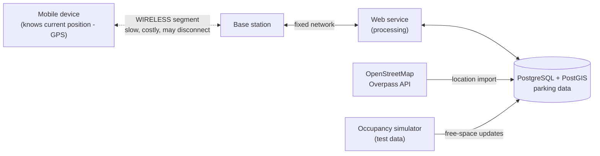

# Mobile Parking Finder

**Course:** Mobile Databases — Lab 01: Project setup and architecture
**Topic:** Parking search (nearest available parking facility)

## Developer

| Name | Role |
|---|---|
| Emre Aracı | Individual project — mobile app, web service, database, data import and testing |

---

## 1. Topic decision

We chose **parking search**. A user asks for the nearest available parking facility from their current position, sees a list or map of results with the number of free spaces, and gets directions to the chosen facility.

This topic fits the course well because the answer depends on the user's **position**, and the user is usually **moving** (driving) while the request is processed. A result can be correct at the moment it is computed and already stale when it is delivered.

---

## 2. System components

| Component | Responsibility | Technology |
|---|---|---|
| Mobile app | Reads the device location, sends queries, displays results on a map, caches the last result | Flutter (Android / iOS) |
| Web service | Receives requests, validates them, runs nearest-neighbour queries, returns results with timestamps | Spring Boot (Java), REST/JSON |
| Database | Stores parking facilities, locations, capacity and current availability | PostgreSQL + PostGIS (spatial index, nearest-neighbour search) |
| External data source | Provides parking facility locations | OpenStreetMap via Overpass API (`amenity=parking`) |
| Test data generator | Simulates live occupancy (free spaces) for each facility | Scheduled job in the web service |

### Data sources

- **Parking locations:** imported from OpenStreetMap (name, coordinates, capacity where available) for a selected city area, then stored in our database.
- **Availability (free spaces):** real-time occupancy data is generally not publicly available, so we use **simulated test data**. A scheduled job updates the number of free spaces for each facility every minute, following simple daytime/night-time patterns.
- **User location:** taken from the device GPS and sent with each query. The server does not track the user continuously; it only knows the position included in the latest request.

---

## 3. Architecture



Plain-text version:

```
[Mobile device] ~~~ wireless ~~~ [Base station] ---- [Web service] ---- [Database]
 knows current                                         processing        parking data
 position (GPS)                                            |
                                              [OpenStreetMap] + [Occupancy simulator]
```

### Request path

1. The app reads the GPS position and sends `GET /parking/nearest?lat=..&lon=..&requestId=..`.
2. The request travels over the **wireless channel** to the base station, then over the fixed network to the web service.
3. The web service runs a nearest-neighbour query in PostGIS, filtering facilities with free spaces > 0.
4. The response (list of facilities + `computedAt` timestamp + the position used) travels back the same way.
5. If the user has moved to another base station, the response must reach the device through the new attachment point; if the device is disconnected, the response is lost.

### Where things happen

| Point | What is known or done there |
|---|---|
| Mobile device | Current position, last cached result, request ID |
| Wireless segment | Most expensive and least reliable part; responses can be lost here |
| Base station | Interface between the mobile client and the fixed network; changes when the user moves |
| Web service | Processing; knows only the position sent in the request (may already be old) |
| Database | Facility data and availability; correct at query time |

### Data owners

| Data | Owner |
|---|---|
| Parking facility locations | OpenStreetMap (external), copied into our database |
| Free-space counts | Our system (simulated test data) |
| User position | The user's device (sent per request, not stored long-term) |
| Request / query log | Our web service |

### What must stay stable vs. what may change

- **Stable:** request ID, user/session ID, facility IDs.
- **May change:** current position, current base station, free-space counts.

### Reducing wireless traffic

- Return only the nearest N facilities (e.g. 10), not all records.
- Send compact JSON with only the fields the screen needs.
- Cache the last result on the device and show it while offline.

---

## 4. User journeys

### Normal journeys

**N1 — Find nearest free parking**
The user opens the app and taps "Nearest parking". The app sends the current position, receives the 10 nearest facilities with free spaces, and shows them on a map. The user selects one and opens directions.

**N2 — Browse an area**
The user moves the map to their destination area and taps "Search this area". The app shows all facilities in that area with their free-space counts, and the user picks one before starting the trip.

### Journeys interrupted by connectivity loss

**I1 — Response lost while moving**
The user sends a "nearest parking" request while driving and enters a tunnel before the response arrives. The server has computed a correct answer, but it never reaches the device. When the connection returns, the user is several hundred metres away, so the old answer is no longer the nearest. The app should **re-send the query with the new position** instead of showing the old result.

**I2 — Stale result used offline**
The user received a result showing "12 free spaces" and then loses the connection while driving there. On arrival, the facility is full because the data was several minutes old. The app should **show the age of the data** ("updated 6 min ago") and refresh automatically when the connection returns.

---

## 5. Initial risk list

| # | Risk | Effect | Planned mitigation |
|---|---|---|---|
| R1 | **Stale data (position)** | The user moves while the query runs; the "nearest" result is no longer nearest at delivery | Return the position used and `computedAt`; app re-queries if the user has moved more than a threshold distance |
| R2 | **Stale data (availability)** | Free-space count is out of date when the user arrives | Show data age; refresh on reconnect; mark results older than X minutes |
| R3 | **Uncertain outcome after a lost response** | The server processed the request but the response was lost; the client cannot tell if it succeeded. Critical if a reservation feature is added (risk of double booking) | Every request carries a unique `requestId`; the server logs it and returns the stored result if the same ID is repeated (idempotent requests) |
| R4 | Disconnection / power saving | The app cannot reach the service | Cache last result; queue the request; retry with backoff |
| R5 | Inaccurate or missing GPS | Wrong "nearest" results | Show accuracy; allow manual location selection |
| R6 | External source incomplete or unavailable | Missing facilities | Import OSM data into our own database instead of calling it per request |
| R7 | Simulated availability is unrealistic | Testing may not reflect real behaviour | Document clearly that availability is test data; use simple time-of-day patterns |

---

## 6. Repository structure (planned)

```
mobile-parking-finder/
├── README.md
├── docs/            architecture diagrams, lab reports
├── mobile-app/      Flutter client
├── web-service/     Spring Boot REST API
├── database/        schema, PostGIS setup, seed/test data
└── data-import/     OpenStreetMap import scripts
```

## 7. Setup

_To be completed in later labs._
