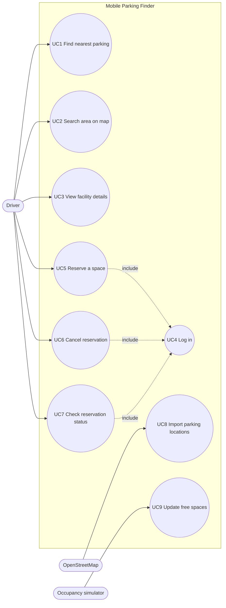
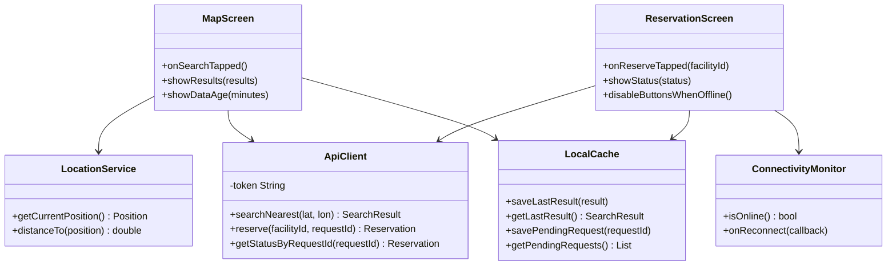
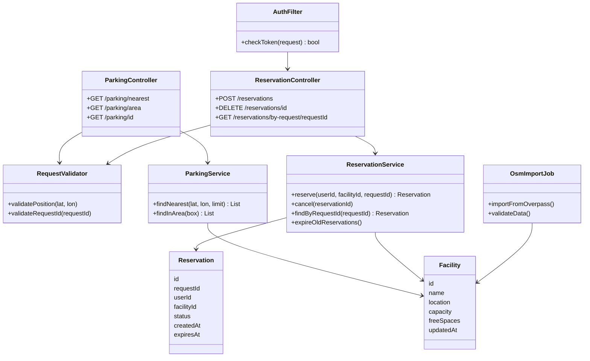
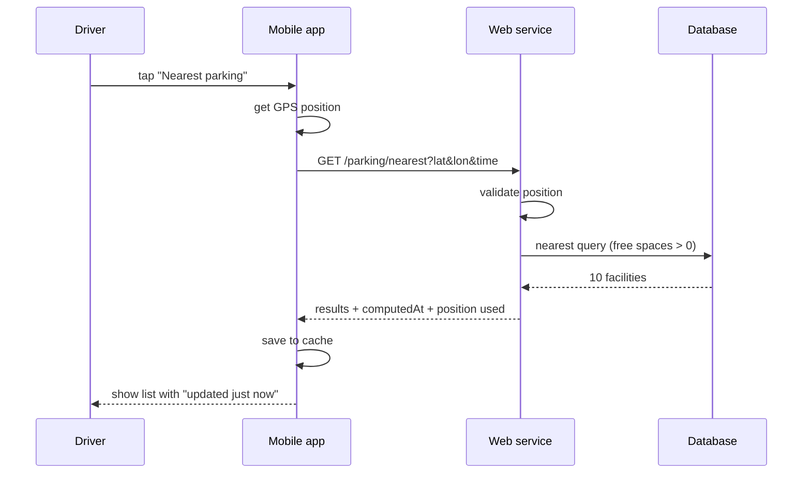
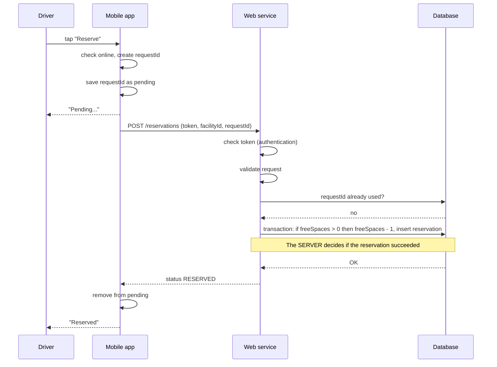
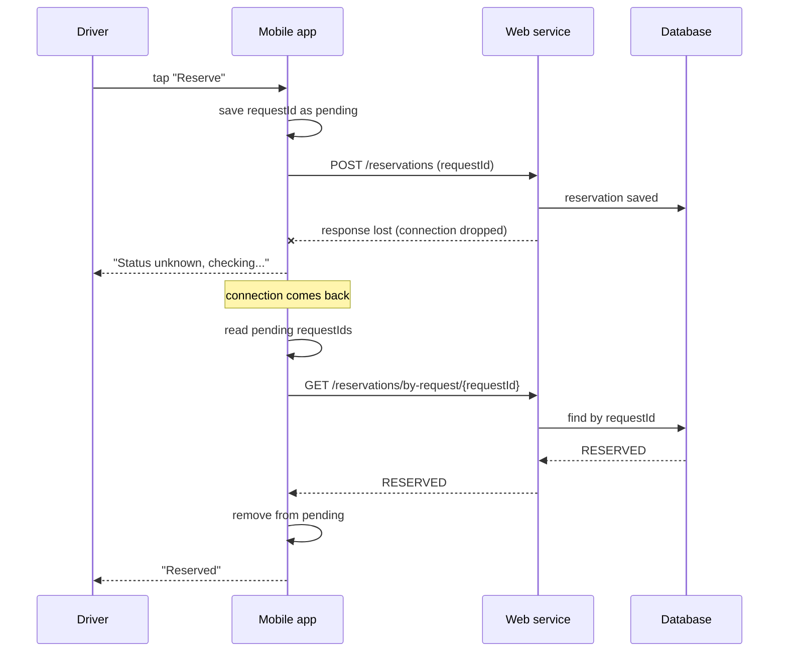
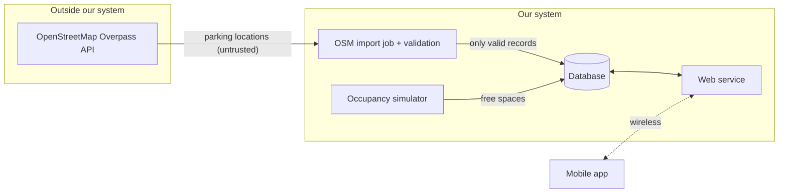

# Lab 03 – Use Cases, Classes and Data Flow

Project: Mobile Parking Finder
Emre Aracı

All diagrams are written in Mermaid, so they can be edited as text and GitHub draws them automatically.

## 1. Use case diagram

Actors:
- **Driver** – the person using the app
- **OpenStreetMap** – external source of parking locations
- **Occupancy simulator** – updates free space counts (test data)

For reservations the user has to log in, so I added a simple login with a token. Searching works without login.

## 2. Class diagrams

### Mobile app

### Web service

## 3. Data flow – normal read (find nearest parking)

No login is needed here, because it only reads data.

## 4. Data flow – data changing action (reserve)

**Who decides success?** Only the web service, inside the database transaction. The app never decides by itself. It only shows what the server answered.

## 5. Interrupted action and recovery after reconnect

If the server answers NOT_FOUND, the request never arrived, so the app shows "Not reserved, try again". Because the same requestId is used, sending again can't create a second reservation.

## 6. External data boundary

OpenStreetMap data comes from outside, so it is checked before saving (missing coordinates, duplicates, places outside the city area). The app never calls OpenStreetMap directly. It only talks to our web service.

## 7. Explaining one path

Reservation path (section 4 and 5): the user taps Reserve and the app creates a request ID and saves it as pending before sending. The server checks the token, validates the request and then does the reservation in one transaction, so two users can't take the last space. If the answer gets lost, the app still has the request ID. When the connection comes back, it asks the server what happened with that ID and shows the real result. This way the user never sees a wrong "Reserved" or a double reservation.

## 8. Requirements mapping

| Requirement (Lab 02) | Use case | Responsible component |
|---|---|---|
| FR1 send location with search | UC1 | LocationService, ApiClient |
| FR2 10 nearest parkings | UC1 | ParkingService |
| FR3 show data age | UC1, UC2 | MapScreen, LocalCache |
| FR4 search again after moving | UC1 | MapScreen, LocationService |
| FR5 unique request ID | UC5, UC6 | ApiClient, RequestValidator |
| FR6 same request ID only once | UC5 | ReservationService |
| FR7 reserve only if space is free | UC5 | ReservationService (DB transaction) |
| FR8 "Reserved" only after confirmation | UC5 | ReservationScreen |
| FR9 check unknown result by ID | UC7 | ReservationScreen, ReservationController |
| FR10 buttons disabled offline | UC5, UC6 | ReservationScreen, ConnectivityMonitor |
| FR11 cache last result | UC1, UC7 | LocalCache |
| NFR5 free spaces never negative | UC5 | ReservationService |
| Login for reservations (new) | UC4 | AuthFilter |

## Connection to SEARCH (week 3)

Our app doesn't need to search for the user, because the user always starts the request and the answer goes back on the same connection. But the recovery in section 5 is similar to the idea in the lecture: if delivery fails, we don't keep retrying the old route. The app asks again when it is reachable.
